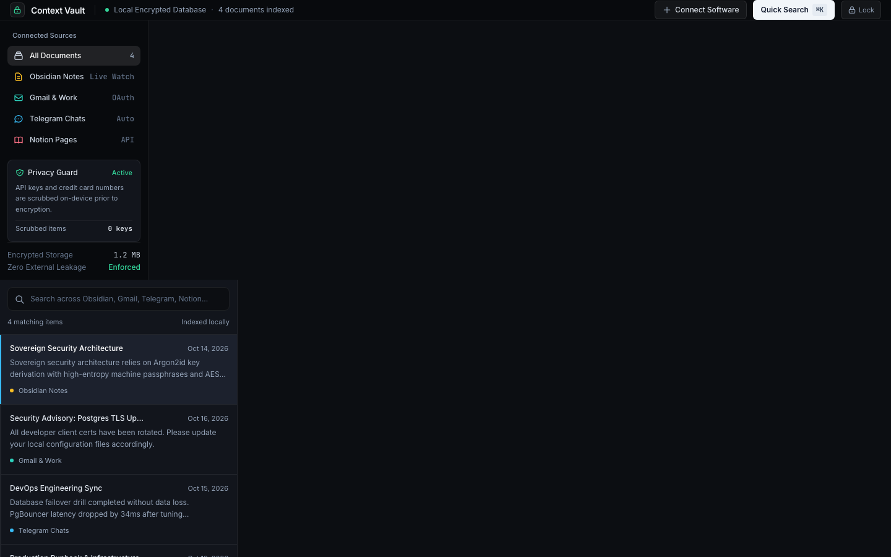
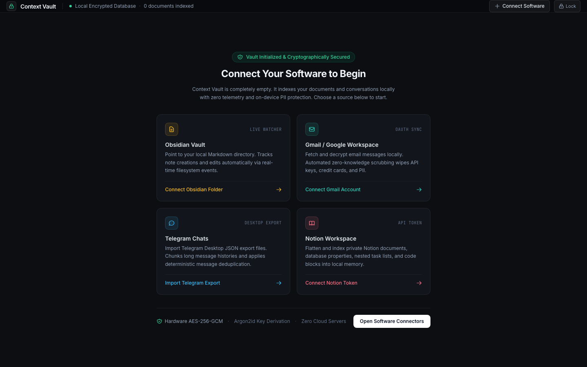
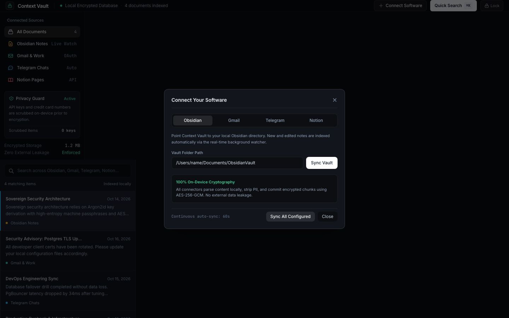
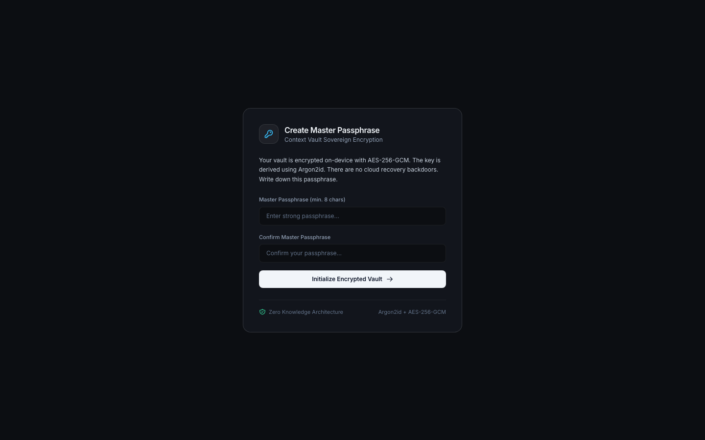
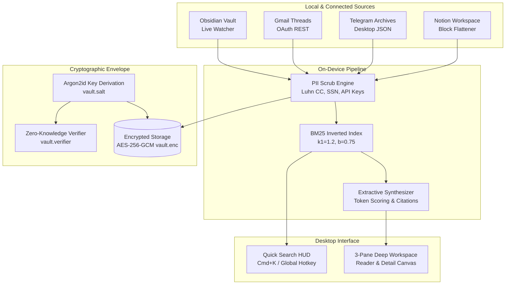

# Context Vault

> Sovereign, 100% on-device desktop memory search engine for macOS. Indexes communications and notes across Obsidian, Gmail, Telegram, and Notion with hardware-accelerated AES-256-GCM encryption, Argon2id key derivation, and automated PII scrubbing.

[](https://tauri.app/)
[](https://www.rust-lang.org/)
[](https://react.dev/)
[](crates/vault-crypto)
[](crates/vault-crypto)
[](LICENSE)

---

## Overview

Context Vault allows knowledge workers, developers, researchers, and executives to instantly search, verify, and cite past conversations, agreements, decisions, and documentation across their digital life in sub-15ms, without sending any private data to cloud providers.

Unlike cloud AI search assistants that upload unencrypted communications to remote infrastructure, Context Vault is **100% local-first**. Every message, note, and token is parsed on your CPU, sanitized on-device, and committed to hardware-isolated encrypted storage.



---

## Core Product Guarantees

* **Zero Plaintext on Disk**: Communications, inverted indices, and authentication states are encrypted with AES-256-GCM. The encryption key is derived dynamically in memory via Argon2id.
* **Zero Cloud Backends**: No background telemetry, no remote databases (no Docker, PostgreSQL, or Redis), and no external API leakage.
* **On-Device PII Protection**: Automated scrubbing detects and redacts Luhn-validated credit cards, Social Security numbers, internal API tokens (`sk_live`, `ghp_`, `xoxb-`), and phone numbers before documents are committed.
* **Sub-15ms BM25 Retrieval**: Embedded BM25 inverted index featuring term frequency saturation ($k_1 = 1.2$) and document length normalization ($b = 0.75$).
* **Factual Memory Synthesis**: High-density extractive synthesis extracts exact sentences matching query terms with direct source and timestamp attribution.
* **Authentic First-Run Experience**: Fresh installations initialize with zero synthetic or mock documents, presenting a guided setup screen to connect real data sources.

---

## Interface Showcase

### 1. First-Run Onboarding (Empty State)
When launching Context Vault for the first time, your vault begins in a clean state with 0 records. Guided setup cards let you connect your local Obsidian vault, personal Gmail, Telegram archives, or Notion workspace.



### 2. Software Connectors Configuration
Connect multiple software sources through unified credential and folder management. Configured sources run continuous 60-second synchronization with automatic deduplication.



### 3. Master Passphrase & Vault Lock Lifecycle
All cryptographic keys are derived locally from your Master Passphrase. A zero-knowledge authenticated verifier ensures your passphrase is validated without storing any plaintext secret file on disk.

| Setup Master Passphrase | Hardware-Isolated Vault Lock |
| :--- | :--- |
|  |  |

---

## Supported Software Connectors

| Connector | Mechanism | Features |
| :--- | :--- | :--- |
| **Obsidian** | Real-time filesystem watcher (`fsevents`) | Tracks `.md`, `.markdown`, `.txt`, and `.org` files. Automatically strips YAML frontmatter and resolves `[[wikilinks]]`. Re-indexes edits live on save. |
| **Gmail** | Incremental REST API Sync | Fetches unindexed email threads via OAuth or app password. Wipes API tokens, credit cards, and PII prior to encryption. |
| **Telegram** | Desktop Export Ingestion | Parses `result.json` exports. Breaks continuous conversations into message chunks and enforces deterministic content deduplication. |
| **Notion** | Workspace Block Flattener | Recursively traverses Notion block trees (headings, callouts, nested bullets, code blocks) via Internal Integration token. |

---

## Architecture & Data Flow



---

## Getting Started

### Prerequisites

* macOS 12 Monterey or higher
* [Rust](https://www.rust-lang.org/tools/install) (1.80 or newer)
* [Node.js](https://nodejs.org/) (18.x or newer)
* [pnpm](https://pnpm.io/) (`corepack enable pnpm`)

### Installation & Development

1. **Clone the repository**:
   ```bash
   git clone https://github.com/SvayMonirath/context-search.git
   cd context-search
   ```

2. **Install frontend dependencies**:
   ```bash
   pnpm install
   ```

3. **Start the application in development mode**:
   ```bash
   pnpm dev
   ```

4. **Build production application bundle**:
   ```bash
   pnpm tauri build
   ```
   The compiled `.dmg` and `.app` bundles will be generated under `src-tauri/target/release/bundle/`.

---

## Keyboard Shortcuts

| Shortcut | Scope | Action |
| :--- | :--- | :--- |
| `Cmd + K` | In-App | Open Quick Search Spotlight HUD |
| `Cmd + Shift + Space` | System-Wide | Open Global Quick Search overlay from any macOS app |
| `Esc` | In-App | Dismiss modals and return to main reading workspace |
| `Enter` | Spotlight | Select highlighted document and open full reader view |

---

## Workspace Structure

```
context-search/
├── crates/
│   ├── vault-connectors/    # Ingestion engines: Obsidian, Gmail, Telegram, Notion
│   ├── vault-crypto/        # AES-256-GCM, Argon2id, and Zero-Knowledge verifier
│   ├── vault-index/         # BM25 engine, inverted index, extractive synthesis
│   └── vault-pii/           # Deterministic PII regex & Luhn-validated scrubbing
├── src-tauri/
│   ├── src/commands.rs      # Tauri IPC handlers & lock state management
│   ├── src/lib.rs           # Background watcher thread & application state
│   └── Cargo.toml           # Native macOS desktop runtime definition
├── ui/
│   ├── src/App.tsx          # React 19 interface (Onboarding, Lock, 3-Pane Reader)
│   ├── src/main.tsx         # Frontend bootstrapper
│   └── vite.config.ts       # Vite bundler configuration
├── docs/assets/             # UI screenshots and visual architecture assets
├── audit-research-report.md # Ground-truth codebase integrity audit report
└── PRODUCT.md               # Product requirements and security constraints
```

---

## Testing & Verification

Run the full Rust verification suite (36 unit and integration tests across 6 workspace crates):

```bash
cargo test --workspace
```

Verify the frontend TypeScript build:

```bash
pnpm --prefix ui build
```

Run the visual design taste linter:

```bash
node ~/.gemini/config/skills/design-taste-frontend/scripts/lint.mjs ui/src/App.tsx
```

---

## Security Policy

* Passphrases are never written to disk in plaintext.
* Encrypted vaults default to POSIX permissions `0600` (owner read/write only).
* PII scrubbing is applied synchronously before plaintext hits memory indexing structures.
* Continuous auto-sync intervals run strictly against localhost network sockets or user-authorized API endpoints.

---

## License

This project is licensed under the [MIT License](LICENSE).
